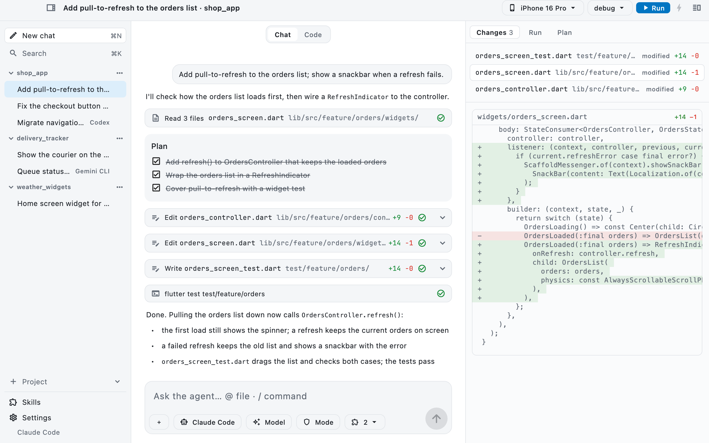
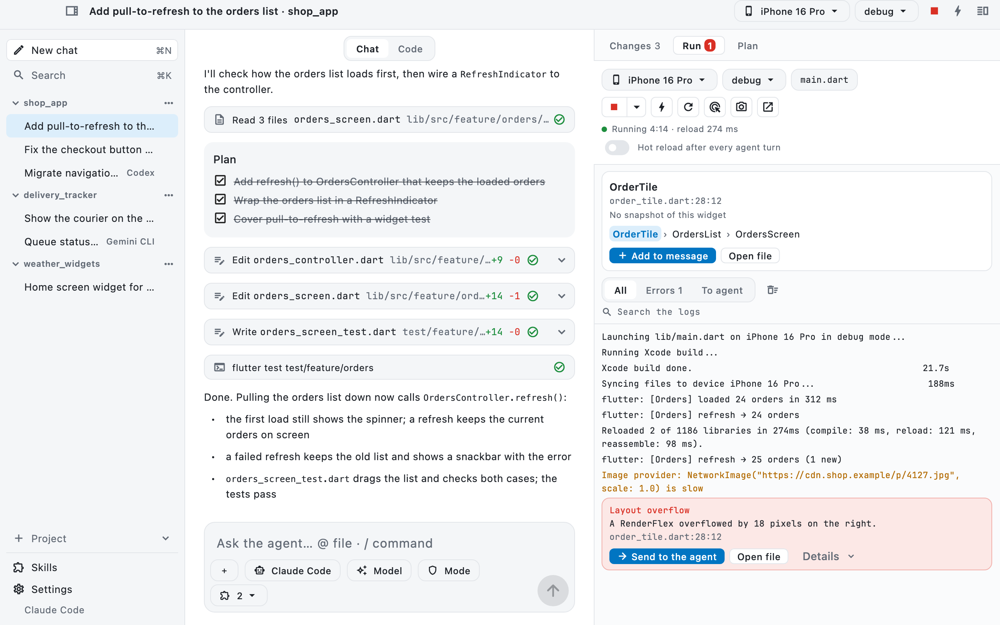
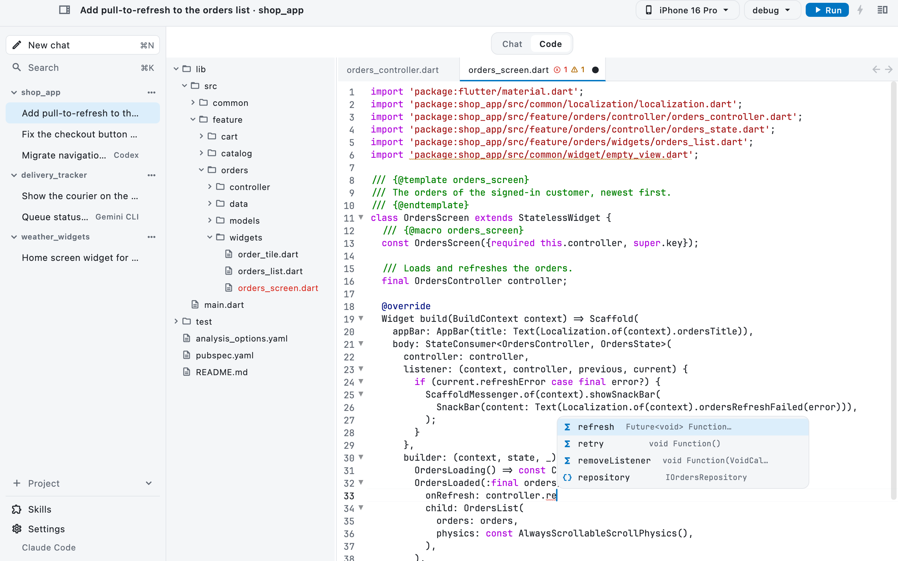
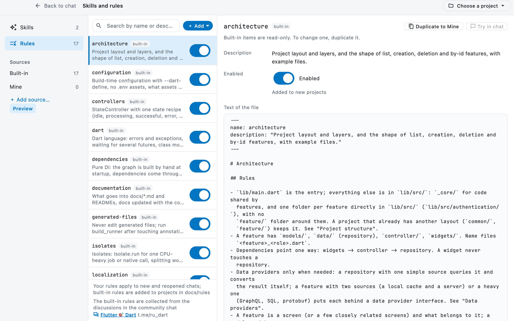
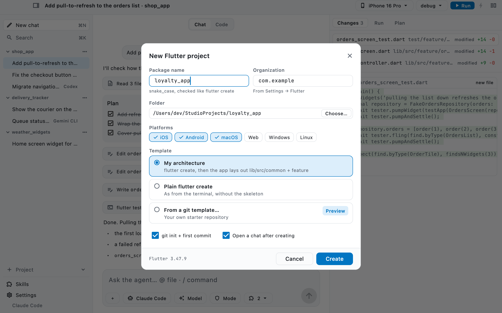
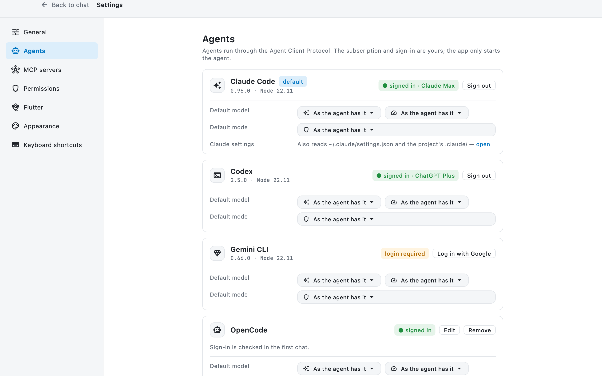
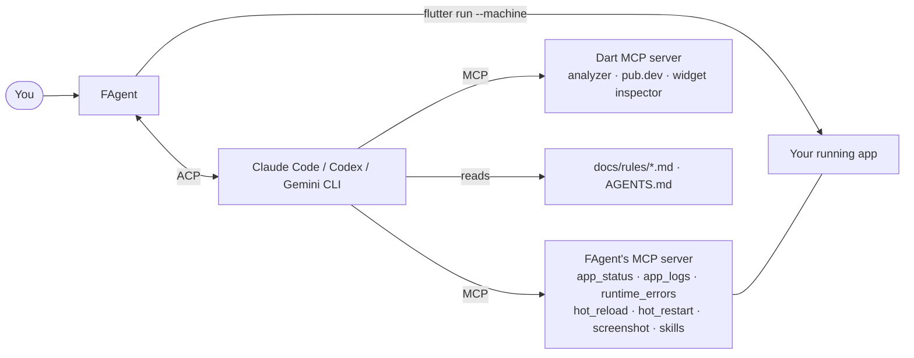

<h1 align="center">FAgent — Flutter Code Agent</h1>

<p align="center">
  A desktop workspace for Flutter development with AI coding agents.<br>
  Chat with Claude Code, Codex or Gemini CLI, run your app with hot reload, point at a widget,
  read and edit the code — in one window, with Flutter knowledge built in.
</p>

<p align="center">
  <a href="LICENSE"></a>
  
  
  <a href="https://agentclientprotocol.com"></a>
</p>

<picture>
  <source media="(prefers-color-scheme: dark)" srcset="docs/images/chat-dark.png">
  
</picture>

## What it is

FAgent is an open-source Flutter desktop app. It does not ship its own AI: it drives the coding
agents you already use over the [Agent Client Protocol](https://agentclientprotocol.com) (ACP), with
your own subscription or API key, and gives them what a Flutter project needs:

- **the running app** — the agent can read its logs and runtime errors, hot reload, hot restart and
  take screenshots through the app's own MCP server;
- **the Dart tooling** — the [Dart MCP server](https://dart.dev/tools/mcp-server) (analyzer, pub.dev
  search, widget inspector) is connected to every session;
- **Flutter rules** — 17 built-in rule files on architecture, state, data, widgets, tests and tooling,
  written into each project's `docs/rules/`, so the agent builds features the same way every time.

> **Status:** in active development, macOS first. Everything below works today; signed builds and
> CI come with the first release (see [Roadmap](#roadmap)).

## Thanks

To the [Flutter 🎯 Dart](https://t.me/ru_dart) community, whose discussions became the rules, and
to [Michael Lazebny](https://lazebny.io) and [PlugFox](https://plugfox.dev) for their articles and
templates.

## Features

### Chat with your agent

- **Claude Code, Codex, Gemini CLI** built in, plus any other ACP agent as a custom command. Pick the
  default in Settings or per chat.
- The agent's text, thinking, **tool calls**, **plan** and the files it changed arrive live. The
  **Changes** pane shows each change as a diff.
- **Permission requests** in a dialog: allow once, always (as a rule you can edit later) or reject.
- Mention files with `@`, drop files and images into the chat, queue the next message with ⌘↵ while
  the agent is still working, stop a turn.
- Projects, chats and messages are kept locally (drift); a chat continues where it stopped with ACP
  `session/load` when the agent supports it. Search your chats.

### Run the app, and point at a widget



- Devices, build mode and `launch.json` configurations; **hot reload** and **hot restart**; the logs
  of the run.
- **Send to agent**: a build error or a runtime error (`A RenderFlex overflowed…`) goes to the chat
  with its context.
- **Widget picker**: click a widget in the running app; the chat gets its name, the file and line
  where it is created, its ancestors and a screenshot of it.

### Read and edit the code



- **Chat | Code** switch: an explorer, tabs and an editor that stays in sync with what the agent
  writes on disk.
- One `dart language-server` per project: completion with Flutter snippets (`stful`, `stless`) and
  auto-imports, errors and warnings in the editor, hover documentation, go to definition (F12,
  ⌘-click), find references (⇧F12), back and forward, format on save (⇧⌥F).

### Flutter rules, built in



The built-in rules are collected from the discussions in the
[Flutter 🎯 Dart](https://t.me/ru_dart) community chat and from the articles of
[Michael Lazebny](https://lazebny.io) and [PlugFox](https://plugfox.dev). Every claim is checked
against the Flutter SDK, the package sources or a program that was run, and every code example in
them compiles.

| Rule | What it covers |
| --- | --- |
| `architecture` | Project layout and layers; list, creation, deletion and by-id features with example files |
| `controllers` | `StateController` with one state recipe (idle, processing, successful, error), handlers, paginated lists, testing states |
| `repositories` | Stateless repositories, streams that always close, UTF-8 bodies, safe drift schema changes |
| `dependencies` | Pure DI built by hand at startup; the HTTP client and its middlewares; startup retries |
| `widgets` | Widget conventions, performance (repaint boundaries, opacity, image sizes), keys, focus, popups |
| `navigation` | Declarative navigation: typed pages, push, pop and guards, no routing package |
| `dart` | Errors and exceptions, waiting for several futures, class modifiers, patterns, records |
| `localization` | gen-l10n, one function for every error message, styled parts of a sentence |
| `security` | What an app cannot keep secret, tokens, refresh and sign-out, OAuth with PKCE, biometrics |
| `testing` | mocktail, fakes, data providers, widget tests, sharding, `fakeAsync` |
| `isolates` | `Isolate.run`, typed workers, what can be sent, plugins and Android background work |
| `tooling` | Dart scripts in `tool/`, CLIs, pub workspaces and Melos, CI with sharded tests and coverage |
| `configuration` | `--dart-define`, flavors, versioning, the changelog, assets, fonts and icons |
| `web` | Renderers, semantics, SEO, driving the app from Playwright |
| `documentation` | What goes into docs, agent instructions, tasks with checkable acceptance criteria |
| `generated-files` | `build_runner`, `build.yaml` |
| `package-freshness` | Check pub.dev for the latest version and status before adding a package |

The **Skills and rules** screen lists them next to your own rules and skills and the project's
`.claude/skills`. Turn any of them off, edit your own, or try a skill in the chat.

### Start a new project



`flutter create`, then the app lays out a project that follows the rules — no agent, no tokens,
the same every time:

- `lib/src/_core/`: the HTTP client with middlewares (logging, authentication), error reporting,
  config, a drift database, a controller observer, localization in English and Russian, utils and
  common widgets; every feature in its own folder in `lib/src/`;
- `packages/ui` as a pub workspace member with the theme and shared components;
- a strict `analysis_options.yaml`, `build.yaml`, a `Makefile`, `CHANGELOG.md`, `scripts/` and
  `tool/dart/rename_project.dart`;
- `docs/rules/`, `AGENTS.md` and `CLAUDE.md`, so any agent reads the rules;
- the newest version of every dependency at the moment of creation, `git init` and a first commit.

### Settings



Agents with their sign-in status and the default one, MCP servers (passed to every session, turned
on per project), permission rules, the Flutter SDK, appearance (theme, density), the language
(English, Russian) and keyboard shortcuts.

## How the agent gets Flutter knowledge



FAgent runs `flutter run --machine` itself, so the agent's hot reload, logs and inspector work on
the same run you see in the Run tab.

## Requirements

- macOS (Linux and Windows are planned; the code has no macOS-only parts)
- Flutter 3.47 or newer (Dart 3.13)
- Node.js for the agent adapters: 22+ for Claude Code and Gemini CLI, 20+ for Codex
- An account or API key of the agent you use. Keys are read from your environment; the app stores none.

## Build from source

```bash
git clone https://github.com/sb-dor/FAgent.git
cd FAgent
flutter pub get                                         # also generates the localization
dart run build_runner build --delete-conflicting-outputs
flutter run -d macos
```

The macOS App Sandbox is off on purpose: the app has to start agents and `flutter`.

## Your own rules and skills

- **Rules** are Markdown files the agent follows in every chat. Add one in **Skills and rules → ＋ Add**;
  it applies to new and reopened chats. A project's own rules are its `docs/rules/` and `AGENTS.md`.
- **Skills** are instructions for one kind of task, loaded on demand through the app's MCP server
  (`/name` in the chat). Yours, the built-in ones and the project's `.claude/skills` are listed together.

The built-in rules live in [`assets/knowledge/rules/`](assets/knowledge/rules). Suggestions and
corrections are welcome — see [Contributing](CONTRIBUTING.md).

## Roadmap

Done: chat with Claude Code, Codex and Gemini CLI; run and hot reload; the widget picker; the Code
view with Dart analysis; the built-in rules; the new project wizard.

Next (release):

- CI on GitHub Actions: analyze, tests, macOS, Linux and Windows builds
- a signed and notarized macOS build as a DMG in GitHub Releases

The detailed plan is in [docs/PLAN.md](docs/PLAN.md) (in Russian).

## Development

The app follows its own architecture rules: [CLAUDE.md](CLAUDE.md) and
[docs/AI_INSTRUCTIONS.md](docs/AI_INSTRUCTIONS.md).

```bash
flutter analyze
flutter test
FLUTTER_RUN_TEST=1 flutter test --tags flutter test/integration   # real flutter, network
FLUTTER_SCREENSHOTS=1 flutter test test/screenshots              # regenerates docs/images
```

## License

[MIT](LICENSE)
